<!-- Every card is an animated SVG drawn by scripts/render_readme_cards.py and refreshed daily
     by .github/workflows/update-profile-art.yml. Design: "Onyx" — near-black + silver, cyan accent.
     Spacing is baked into the SVGs, so keep this block free of blank lines and keep the cards in
     a row on one line with no spaces between them. -->

 
 
 
 
<picture><source media="(prefers-color-scheme: dark)" srcset="./cards/title-coding-dark.svg" /></picture> 

  <a href="https://www.youtube.com/@stream-pixel">YouTube</a> ·
  <a href="https://www.tiktok.com/@youranonone_">TikTok</a> ·
  <a href="https://discord.gg/GQts8Fmdre">Discord</a> ·
  <a href="https://amanxdev0.github.io/portfolio/">Portfolio</a>

  <i>Crafted by Aman Singh</i>

